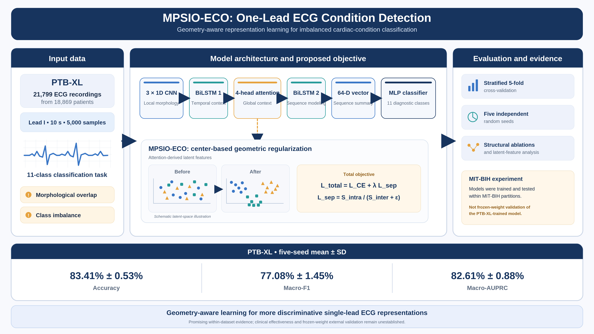

# MPSIO-ECO

**One-Lead ECG Condition Detection via Most Possible Separation Index Optimization**

<p align="center">
  
</p>


<p align="center">
  <strong>Geometry-aware representation learning for single-lead ECG classification.</strong>
</p>

---

This repository contains the research implementation of **MPSIO-ECO**, a
representation-learning framework for single-lead electrocardiogram (ECG)
classification.

The proposed framework combines convolutional feature extraction,
bidirectional recurrent modeling, multi-head self-attention, and a
center-based separation-index objective to encourage compact
within-class representations and improved separation between
different cardiac-condition classes.

### Repository contents

- **Alpha:** Proposed CNN–BiLSTM–attention architecture trained using MPSIO-ECO.
- **Alpha-CE:** Matched full-architecture cross-entropy baseline.
- **Architectural ablations:** Beta, Gamma, Delta, and Epsilon.
- **MPSIO-ECO loss:** Center-based latent-space separation objective.
- **Experimental evaluation:** Cross-validation, multiple random seeds,
  and architectural comparisons.
- **Feature analysis:** Latent-feature ranking, Random Forest classification,
  and feature pruning.
- **MIT-BIH experiments:** Beat-level classification workflows.
- **Statistical analysis:** Paired comparisons and effect-size calculations.
- **Synthetic experiments:** Toy datasets illustrating geometric optimization.

The implementation is written in Python and PyTorch.

> **Reproducibility note:** The repository supports user-defined classification
> tasks. Dataset-specific label mappings and preprocessing should be supplied
> by the researcher. The example rhythm labels documented below are not
> hard-coded as the manuscript's PTB-XL target classes.

---

## 1. Method overview


MPSIO-ECO combines a predictive cross-entropy objective with a center-based
latent-space separation regularizer:
$$
\mathcal{L}_{\text{total}} = \mathcal{L}_{\text{CE}} + \lambda \mathcal{L}_{\text{sep}},
\qquad \lambda = 1.
$$

For a mini-batch, let $$h_i$$ be the time-pooled attention representation and
$$\mu_c$$ the mean representation for class $$c$$. The paper's ECG objective
uses

$$
S_{\text{intra}} =
\frac{1}{|C'|}
\sum_{c \in C'}
\frac{1}{|I_c|}
\sum_{i \in I_c}
\|h_i - \mu_c\|_2^2,
$$

$$
S_{\text{inter}} =
\frac{2}{|C'|(|C'|-1)}
\sum_{c<c'}
\|\mu_c - \mu_{c'}\|_2,
$$

$$
\mathcal{L}_{\text{sep}} =
\frac{S_{\text{intra}}}{S_{\text{inter}}+\epsilon}.
$$

A class is eligible for the mini-batch estimate when it has at least two
examples. If fewer than two eligible classes are present, the implementation
returns a differentiable zero for that batch. This avoids a shape or gradient
failure; it does not fabricate class-center estimates.

### Alpha architecture

`AlphaECGNet` implements the full model:

1. Three 1-D CNN stages (channels 1 → 16 → 32 → 64) for local morphology.
2. A bidirectional LSTM (hidden size 32 per direction).
3. Four-head self-attention with residual connection and layer normalization.
4. Mean pooling of the post-attention sequence to a 64-dimensional vector for
   the separation objective.
5. A second bidirectional LSTM and an MLP prediction head for the class logits.

For the 11-class configuration, the model has **110,619 trainable parameters**,
matching the count reported in the manuscript.

### Models included

| Model | Architecture | Training objective |
|---|---|---|
| `alpha` | CNN + BiLSTM + 4-head attention + BiLSTM | CE + \(\lambda\) SI |
| `alpha_ce` | Same full architecture as Alpha | CE only; matched control |
| `beta` | CNN + 4-head attention | CE only |
| `delta` | CNN + BiLSTM + BiLSTM | CE only |
| `epsilon` | BiLSTM + 4-head attention + BiLSTM (no CNN) | CE only |
| `gamma` | CNN + global average pooling | CE only |

The class count is supplied at model construction time, so the same code can
run two-, five-, or eleven-class experiments without duplicating architectures.

## 2. Repository layout

```text
mpsio-eco/
├── configs/
│   ├── default_experiment.yaml
│   ├── task_2_class.yaml
│   ├── task_5_class.yaml
│   └── task_11_class.yaml
├── data/
│   ├── README.md
│   └── manifest_template.csv
├── experiments/
│   ├── exploratory_open_set_distance.py
│   ├── toy_mpsio.py
│   └── train_feature_ranking_encoder.py
├── scripts/
│   ├── analyze_paired_statistics.py
│   ├── build_manifest_from_workbook.py
│   ├── evaluate_mitbih.py
│   ├── model_summary.py
│   ├── run_experiments.py
│   └── run_feature_ranking.py
├── src/mpsio_eco/
│   ├── data.py
│   ├── feature_ranking.py
│   ├── losses.py
│   ├── metrics.py
│   ├── mitbih.py
│   ├── models.py
│   ├── seed.py
│   ├── splitting.py
│   ├── statistics.py
│   └── training.py
├── tests/
├── CITATION.cff
├── pyproject.toml
├── requirements.txt
└── README.md
```

## 3. Installation

Python 3.10 or newer is recommended. Create an environment and install the
package and dependencies:

```bash
python -m venv .venv
# Windows PowerShell: .venv\Scripts\Activate.ps1
# macOS/Linux: source .venv/bin/activate
python -m pip install --upgrade pip
pip install -e .
```

For development and tests:

```bash
pip install -e ".[dev]"
pytest
```

The code automatically selects CUDA when available; pass `--device cpu` or
`--device cuda` to override it.

## 4. Prepare the ECG manifest

Training uses a manifest rather than hard-coded paths or notebook variables.
See [`data/README.md`](data/README.md) for the complete schema.

Required columns:

```csv
recording_path,label,patient_id,record_id
signals/record_0001.csv,CLASS_A,PATIENT_001,record_0001
signals/record_0002.csv,CLASS_B,PATIENT_002,record_0002
```

`patient_id` is strongly recommended and is required by default for the
patient-independent training split. If the data source does not provide it, do
not substitute a recording ID and claim patient-level independence.

### Supplied workbook format

If your input is the workbook-based source used in one of the uploaded
notebooks, prepare the manifest with:

```bash
python scripts/build_manifest_from_workbook.py \
  --labels data/Diagnostics.xlsx \
  --ecg-dir data/ECGData \
  --output data/manifest.csv \
  --patient-column PatientID
```

Omit `--patient-column` only if no patient-ID field exists; the training
pipeline will then require the explicit `--allow-record-level-split` override.

### PTB-XL

The manuscript's main cohort is PTB-XL, and the analysis uses Lead I from
10-second signals. The repository expects a manifest whose `label` field is the
**final task label**, after applying the manuscript's documented target mapping.
Because the supplied attachments do not contain the complete PTB-XL
multi-label-to-11-class mapping or the 2-/5-class class lists, those mappings
must be provided by the authors. Do not simply treat all SCP statements as
mutually exclusive classes.

### Example dataset: Observed rhythm labels

The supplied `Diagnostics.xlsx` workbook contains 11 distinct
raw rhythm labels:

| Rhythm code |
|---|
| SB |
| SR |
| AFIB |
| ST |
| SVT |
| AF |
| SA |
| AT |
| AVNRT |
| AVRT |
| SAAWR |

These labels are documented for reference only. No class selection,
merging, or task-specific mapping is imposed by the repository.

Researchers can define their own two-, five-, or eleven-class
classification tasks through their preprocessing pipelines.

## 5. Inspect model parameter counts

To inspect a model and verify the expected output/embedding shapes:

```bash
python scripts/model_summary.py --model alpha --num-classes 11 --signal-length 5000
```

The 11-class Alpha model should report 110,619 trainable parameters.

## 5. Run the 2-, 5-, and 11-class experiments

Edit `configs/task_2_class.yaml` and `configs/task_5_class.yaml` to replace the
`REPLACE_WITH_...` entries with the exact class strings in your manifest. The
11-class config assumes your manifest already contains exactly the 11 final
labels described in the paper; `run_experiments.py` checks the class count.

Example commands:

```bash
# 11-class primary task: 5 seeds × 5 folds, with 64/16/20 train/validation/test
python scripts/run_experiments.py \
  --manifest data/manifest.csv \
  --task-config configs/task_11_class.yaml \
  --protocol cv \
  --models alpha,alpha_ce,beta,delta,epsilon,gamma \
  --seeds 42,123,456,789,999 \
  --output outputs/main

# Two-class task
python scripts/run_experiments.py \
  --manifest data/manifest.csv \
  --task-config configs/task_2_class.yaml \
  --protocol cv --output outputs/task_2_class

# Five-class task
python scripts/run_experiments.py \
  --manifest data/manifest.csv \
  --task-config configs/task_5_class.yaml \
  --protocol cv --output outputs/task_5_class
```

For the manuscript's matched five-seed comparison on one held-out partition
per seed, use `--protocol seeded_holdout`:

```bash
python scripts/run_experiments.py \
  --manifest data/manifest.csv \
  --task-config configs/task_11_class.yaml \
  --protocol seeded_holdout \
  --models alpha,alpha_ce \
  --seeds 42,123,456,789,999 \
  --output outputs/matched_five_seed
```

The default training settings follow the manuscript's ECG protocol: 30 epochs,
batch size 32, Adam with learning rate 0.001, and gradient clipping at 1.0.
The default sampler is inverse-frequency weighted sampling, as used in the
supplied training notebook; use `--sampling none` to disable it. The separation
weight defaults to 1.0 and is only applied to `alpha`.

### Validation and test partitions

The `cv` protocol uses five outer stratified folds. Each outer fold is the test
set (approximately 20%); one inner fold of the remaining 80% is validation
(approximately 16% overall), leaving approximately 64% for training. If
`patient_id` is present, `StratifiedGroupKFold` keeps all records from a patient
in one partition at both levels. The optional record-level override is for
legacy/exploratory data only and should not be described as patient-independent
validation.

Every fold writes a checkpoint, training history, confusion matrix, per-class
metrics, test predictions and latent arrays. `metrics_all_runs.csv` and
`metrics_summary.csv` aggregate the experiment results.

## 6. Feature ranking and pruning

The primary feature-ranking script consumes the saved attention-derived
64-dimensional embeddings from one Alpha fold. It fits a Random Forest using
training embeddings, ranks latent dimensions by impurity importance, evaluates
top-k subsets on validation data, and evaluates a full-dimensional final model
on the held-out test set. The test set is not used to choose the number of
features.

```bash
python scripts/run_feature_ranking.py \
  --latent-file outputs/main/task_11_class/alpha/seed_42/fold_1/latent_arrays.npz \
  --output outputs/feature_ranking
```

Defaults follow the supplied analysis: 400 trees for initial importance
ranking, 250 trees for each pruning fit, `balanced_subsample` class weighting,
and the top-k values 1, 2, 4, 8, 12, 16, 24, 32, 48 and 64. Feature importance
is model-specific predictive importance; it does not establish physiological
meaning for an individual latent coordinate.

### Auxiliary feature-ranking encoder from the supplied notebook

The uploaded feature-ranking notebook also trained a separate encoder using
`CE + 5 × SI` after L2-normalizing the embeddings and using squared
inter-centroid distances. This is **not the main-paper ECG loss**. To preserve
that experiment, the repository provides:

```bash
python experiments/train_feature_ranking_encoder.py \
  --manifest data/manifest.csv \
  --output outputs/feature_ranking_encoder

python scripts/run_feature_ranking.py \
  --latent-file outputs/feature_ranking_encoder/latent_arrays.npz \
  --output outputs/feature_ranking_encoder/rf_analysis
```

This auxiliary training follows a single stratified record-level 65/15/20
split, as in the supplied code. It is not patient-independent unless the split
is modified and should not be conflated with the primary patient-grouped
benchmark.

## 7. MIT-BIH experiment

The MIT-BIH script reads matched CSV signal files and TXT annotation files. It
uses beat windows of 360 samples (180 before and 180 after each annotation),
keeps N, V and F by default, and splits by source record ID so beats from one
record cannot cross train/validation/test partitions.

```bash
python scripts/evaluate_mitbih.py \
  --data-dir /path/to/mitbih_csv_txt \
  --symbols N,V,F \
  --loss-recipe supcon_center \
  --output outputs/mitbih
```

`supcon_center` matches the supplied MIT-BIH training code:
`CE + 0.5 × supervised contrastive loss + 0.2 × center-margin loss`.
The script also supports `--loss-recipe mpsio` and `--loss-recipe ce`.

**Interpretation:** this workflow trains and tests a model on MIT-BIH. It is not
frozen-weight external validation of the PTB-XL-trained model. The supplied
MIT-BIH source code also uses the supervised-contrastive/center-margin recipe,
not the primary MPSIO objective; the selected recipe is recorded in its output
metadata. The manuscript's limitation on external generalization must remain
explicit.

## 8. Paired statistical analysis

The following command reproduces the five paired accuracy observations in the
manuscript's Alpha versus Alpha-CE comparison:

```bash
python scripts/analyze_paired_statistics.py --use-paper-example
```

It reports a paired t-test, Cohen's \(d_z\), and Wilcoxon signed-rank test. The
paper's paired values produce a mean accuracy difference of 0.0125, paired
t-statistic approximately 4.086 (p approximately 0.0150), and Wilcoxon p-value
0.0625. With only five paired runs, interpret the tests cautiously. To analyze
new runs, provide a CSV with `seed`, `model`, and `accuracy` columns:

```bash
python scripts/analyze_paired_statistics.py \
  --input outputs/main/task_11_class/metrics_all_runs.csv \
  --proposed alpha --baseline alpha_ce --metric accuracy
```

When there are multiple CV folds per seed, the script first averages each
model's fold metrics within each seed; it does not treat folds as independent
seed-level observations.

## 9. Synthetic toy experiments

The manuscript also evaluates MPSIO on circles, moons, spirals, convex blobs,
crossing ellipses and nested disks. The original source for this synthetic
experiment was not among the supplied code files. `experiments/toy_mpsio.py`
is a transparent reconstruction from the manuscript's stated data settings,
loss weights and Armijo-type update, not a recovered copy of the original
experiment archive.

```bash
python experiments/toy_mpsio.py --output outputs/toy_mpsio --iterations 300
```

It writes depth-sweep metrics and input/latent visualizations. Differences from
the original generation code or numerical results should be expected unless
the authors' original synthetic-data generator and implementation are
substituted.

## 10. Implementation corrections and scope notes

The repository consolidates duplicated notebook code and makes the following
corrections/clarifications:

- The pasted Alpha snippet pooled a `[B,T,D]` attention tensor with
  `mean(dim=2)`, which yields `[B,T]` and does not align with the batch labels.
  The corrected implementation pools time using `mean(dim=1)` to obtain
  `[B,D]`, consistent with the paper's attention-derived representation.
- The paper's primary MPSIO separation ratio is implemented in
  `SeparationIndexLoss`. The normalized/squared-distance version from the
  auxiliary feature-ranking notebook is retained under a separate explicit
  name and is never used by the primary Alpha model.
- The full model is called `alpha`; the complete architecture trained with CE
  only is `alpha_ce` (also called Alpha1 in the paper's ablation table).
- Metrics use fixed class labels and handle binary versus multiclass ROC-AUC
  correctly. Per-class specificity and AUPRC are also exported.
- Validation data select the best checkpoint; test data are evaluated only
  after checkpoint selection.
- The MIT-BIH threshold/open-set analysis from the exploratory notebook is
  optional and separate from the paper's main claims. A validation-calibrated
  latent-distance utility is in `experiments/exploratory_open_set_distance.py`.
- The uploaded third notebook included additional SVM, KNN, MLP, SMOTE and
  plotting fragments that were not part of the final manuscript's reported
  method/results and depended on undefined notebook variables. Those duplicate
  exploratory fragments are not merged into the main reproducibility pipeline.

## 11. Reproducibility limitations to resolve before release

1. Reconcile the primary data source: PTB-XL in the manuscript versus the
   separate workbook-described 10,646-patient dataset in one supplied notebook.
2. Commit the exact 11-, 5- and 2-class label definitions and preprocessing
   rules as versioned config/mapping files (without committing patient data).
3. Confirm whether the final manuscript's PTB-XL partitions are patient-grouped.
   The supplied Alpha snippet used `KFold`, not patient grouping; the cleaned
   pipeline uses patient-grouped splits when patient IDs are supplied.
4. Align the MIT-BIH loss recipe in the paper's Methods section with the
   supplied external code, which uses CE + SupCon + center-margin.
5. Confirm that the auxiliary feature-ranking outputs reported in the paper
   correspond to the separate CE + 5 × legacy-SI encoder or to the main Alpha
   checkpoint. Keep their protocols and reported metrics distinguishable.

No raw datasets, trained checkpoints, or result files are included. The code
can be run after adding the authorized data and completing the class mapping.
No software license is included because the authors have not specified one;
choose and add a license before making the repository public.

## 12. Citation

For the manuscript, cite:

Forootani, E., Khodadadi Aski, F., Mahmoudi, S., and Masoudi-Nejad, A.,
“MPSIO-ECO: One-Lead ECG Condition Detection via Most Possible Separation
Index Optimization.”

Please add the final journal citation/DOI to `CITATION.cff` after publication.
